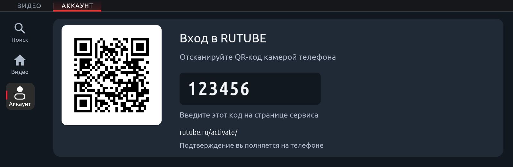

# Видео для MGU

Проект двух отдельных приложений VK Видео и RUTUBE рядом с RideTube. [Техническое задание](SPEC-RU.md).

Тестовый выпуск: VK Видео 0.1.0, RUTUBE 0.1.0, общий сервис 0.4.0. Исходники
находятся в ветке `feature/mgu-vk-rutube`, пакеты — в
[media-preview-0.4.0](https://github.com/istt1899/x3/releases/tag/media-preview-0.4.0).
Обычный стабильный каталог магазина не переключён.

- [Отчёт: реализация, совет, проверки и ограничения](REVIEW-RU.md)
- [Задание независимому проверяющему](REVIEWER-TASK-RU.txt)
- [Установка и приёмка на автомобиле](INSTALL-RU.md)
- [Настройка официального входа VK ID](auth-relay/README.md)
- [Протокол RUTUBE и первичные источники](providers/RUTUBE-RESEARCH-RU.md)
- [Хэши и результаты проверок](RELEASE-EVIDENCE.json)
- [Тестовый каталог](catalog.preview.json)

У VK поиск и публичные видео проверены через настоящую сеть; подключение личного
аккаунта требует своего приложения VK ID, разрешённого доступа к Video API и
настроенного HTTPS callback. Личный контент VK пока не реализован. RUTUBE проверен
до настоящего кода входа и ожидания подтверждения. Проверки на MGU ещё не было.

Картинки в `docs/preview` — симуляция интерфейса с тестовыми карточками и кодом,
а не фотография работающего автомобиля.

`core/` — исходный код RideTube GPL-3.0-or-later из `istt1899/ridetube`, коммит `e89e5e08ac05fcd63d88e34835fcea8a72c2fd01`, с сохранёнными лицензиями и авторством. Общая служба расширяется для нескольких провайдеров; исходная функциональность YouTube сохраняется.

Текущий каталог приложений «Кодировки • X3» не заменяется каталогом видео. Рабочая сборка и испытания новых приложений ведутся отдельно до приёмки.
